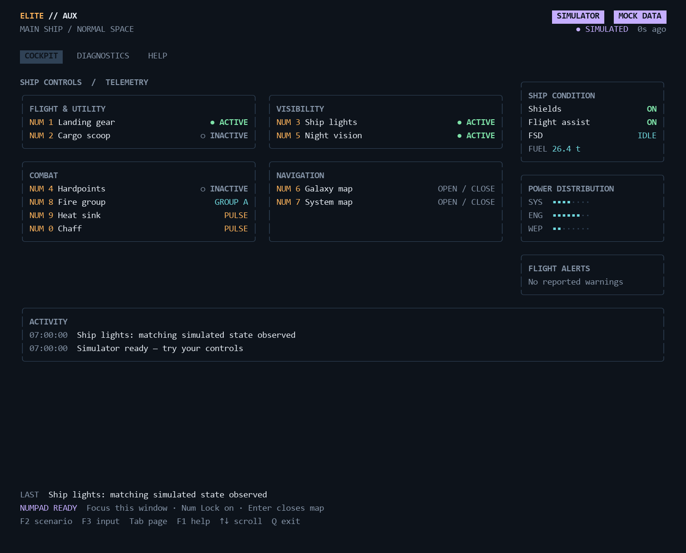
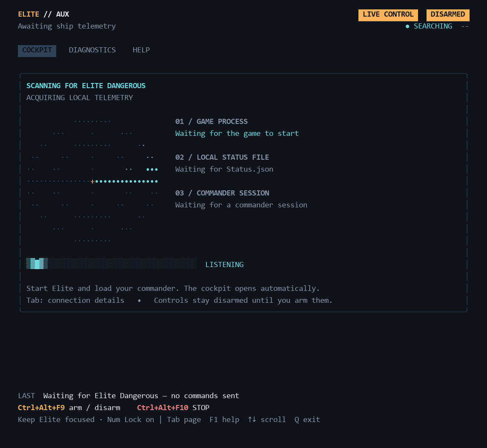

# Elite Aux — cockpit edition

A Go companion panel for Elite Dangerous, built with **Bubble Tea v2** and **Lip Gloss v2**. Controls are grouped into Flight & Utility, Visibility, Combat and Navigation. Gear, cargo scoop, ship lights, hardpoints and night vision report **ACTIVE / INACTIVE** from telemetry. Ship condition, power distribution, fuel, flight warnings and activity history complete the second-monitor display. The original hardware mapping remains gear L1, scoop L2, lights L3 and hardpoints L4.



## Open the app

Open **eliteaux.exe** or **Start.cmd**. The app immediately searches for the running Elite Dangerous process and local telemetry, then opens the cockpit when your commander session is ready. If the game is closed, it keeps scanning and connects when you launch it. Real-game numpad controls are available and start **disarmed**; focus Elite and press **Ctrl+Alt+F9** to arm after setup.

A full-width status strip stays visible on every page: **CONNECTED | DISARMED** uses amber with bright connection borders, while **>>> CONNECTED | ARMED <<<** uses green with green panel borders and a **GAME CONTROLS ACTIVE** label on wider terminals. The window title also follows the state. Searching, setup problems, lost/stale telemetry and mock mode have separate labels; the active green treatment requires current telemetry and the backend's armed acknowledgement. Text labels keep the states distinct without colour.

Shutdown behavior, the safety review, test evidence and abrupt-termination limits are documented in [SAFETY-REVIEW.md](SAFETY-REVIEW.md). The app does not start background services or child processes; application launchers return when it exits.

Mock mode is **off on every normal launch**. With the app focused, press **F4** to toggle it on for testing, then **F4** again to return to the real game. Entering mock mode stops the real backend and releases its hotkeys. Returning discards simulated telemetry and starts a fresh, disarmed scan. The toggle is temporary and never changes the next normal launch.

- **Start-Game-Control.cmd** — same normal startup as opening the EXE.
- **Start-Live.cmd** — actual ship state without sending input.
- **Start-Mock.cmd** — explicitly opt into the simulator with typed commands.
- **Start-Mock-Numpad.cmd** — explicitly opt into the simulator with immediate numpad controls.

The launchers open the new cockpit automatically. Close an already-running app and relaunch it to use an update. The packaged Windows app needs no Go installation, account or network connection to run. For game setup, see [REAL-GAME-SETUP.md](REAL-GAME-SETUP.md). An already-installed EliteAuxPanel preset works with this visual upgrade.

## Navigation

| Key | Action |
|---|---|
| Tab / Shift+Tab | Cycle all nine pages forward/backward |
| Num+ / Num- | Next / previous page; global in real-control mode |
| F1 | Open/close Help |
| F5 | Open/close Settings |
| F6 | Ship Overview (app focused) |
| F7 | Navigation (app focused) |
| F8 | Mission Board (app focused) |
| F9 | Engineering Checklist (app focused) |
| F10 | Hardpoints / fire-group reference (app focused) |
| Up/Down, PgUp/PgDn | Scroll Diagnostics or Help |
| Q / Esc | Quit; Esc first closes a secondary page |
| F4 | Toggle mock mode on/off (app focused) |
| F2 | Cycle mock flight scenarios |
| F3 | Switch mock typed-command/numpad input |
| D | Request disarm from the real-control dashboard |

In typed mock mode, enter a command in the bottom bar and press Enter. Try `t1 on`, `t3 toggle`, `b1`, `scenario docked`, `external t1 off` or `fail`. Pasted commands also require Enter.

**Numpad plus/minus page switching:** in normal real-control mode, **Num+** moves forward and **Num-** moves backward through all nine pages, even while Elite remains focused. These two page keys work while disarmed too and never arm the controller or send game input. Num0–9 retain their existing flight actions. Keep Num+ and Num- unbound in Elite so the physical keys are reserved for paging. In read-only/mock modes, plus/minus navigation works with the app focused when the terminal supplies physical numpad identity; top-row plus/minus keys remain normal text. A page change cancels an unfinished target edit or unsaved theme preview. If Windows cannot register the global page keys, flight control remains available and Diagnostics reports the conflict; local numpad paging and Tab remain available with the app focused.

The footer keeps the latest action and controls visible. Larger windows show category panels and a ship-condition sidebar; smaller windows use compact categories. Windows Terminal with a monospace font such as Cascadia Mono is recommended. **110×36** characters gives the full cockpit, **140×40** adds the sidebar, and **80×24** has a compact layout.

Bubble Tea updates changed cells without clearing the dashboard on each refresh. Indicators stay steady. Set the standard `NO_COLOR` environment variable for monochrome output.

## Themes and settings

Press **F5** to open Settings, or reach it with Tab. Use **Up/Down** to preview a theme, **Enter** to apply and save it, and **Esc** to cancel an unsaved preview. Leaving Settings with Tab, numpad page keys, F1 or F5 also cancels an unsaved preview. Saved themes apply immediately to all nine pages and the connection scanner and are restored on the next launch, including after switching mock mode.

- **Command Deck** — amber highlights, charcoal surfaces and rounded panels (default).
- **Flight Console** — cyan highlights, navy surfaces and square panels.
- **Retro Operations** — phosphor greens, a dark background and double-line console borders.

Themes change colours and panel borders while keeping the same controls and telemetry layout. Warning, pending, unknown and mock labels remain explicit in every theme. Settings are stored separately from game bindings in `%APPDATA%\EliteAux\settings.json` on Windows; `-settings PATH` selects a different appearance settings file. A missing file uses the default theme. Invalid or unwritable settings show an error in Settings and do not stop game detection.

CRT scan lines and glow are terminal-renderer effects. Windows Terminal offers an optional experimental [retro terminal effect](https://learn.microsoft.com/en-us/windows/terminal/customize-settings/profile-appearance#retro-terminal-effects); theme selection does not modify your terminal configuration. All three themes work without it.

## Companion pages

All five pages use the selected terminal theme. They read local Player Journal records, with no account or network connection required. The journal folder defaults to the folder containing Status.json; `-journal PATH` selects another folder. The reader reconstructs the most recent 32 journal files on startup, then follows appended records and new files every 250 ms. Partial trailing records wait for completion, and bad completed records show a warning without stopping the reader. Changing commanders clears the previous commander's data.

- **Ship Overview (F6)** — commander, ship name/type/identifier, game mode, reported tank/cargo capacities, hull, unladen maximum jump range, rebuy and installed modules. Fuel/cargo readings appear when main-ship telemetry is available. Hull and module health show their last-report times; they are not continuous health feeds. SRV/fighter reports do not replace the mothership loadout.
- **Navigation (F7)** — current system, body/station, selected jump target, star class, distance where coordinates are available, remaining route jumps and the plotted route from NavRoute.json. Clearing a route removes its old display. A cached route that does not contain the current system is labelled accordingly. Scoopable class information still requires an installed fuel scoop.
- **Mission Board (F8)** — recorded active missions, destinations, deadlines, rewards and delivery progress when CargoDepot reports it. Startup mission summaries reconcile the active list; acceptance records supply the richer details. Missing acceptance records leave fields unavailable. Completed, failed and abandoned missions leave the active board. An elapsed deadline remains labelled as awaiting the game's mission update rather than inventing a completion/failure.
- **Engineering Checklist (F9)** — offline raw/manufactured/encoded material catalogue, reported inventory and your own pinned target quantities. Inventory follows startup snapshots, collection/discarding, trades, crafting/synthesis and reported material rewards. Unknown inventory displays `?`; a complete snapshot can explicitly report zero. This is a material-target checklist, not an automatic blueprint-recipe planner.
- **Hardpoints (F10)** — all reported hardpoint and utility mounts, ordered by size, plus the selected module's mount type, power state, health, priority and reported clip/reserve ammunition. Status.json supplies the last selected fire group and deployment state when in the mothership. Loadout/ammo are last reported, not continuous counters. Elite's journal does **not** export primary/secondary assignments, so the A–H grid is a clearly labelled manual reference: Up/Down chooses a module, Left/Right chooses a group, top-row **1** assigns primary, **2** secondary, **0** none, and **Delete** restores unknown (`?`). Each change saves immediately to `fire-groups.json` beside appearance settings (`-fire-groups PATH` overrides it). References are isolated by commander, ship ID/type and installed module; replacing a module displays unknown assignments. Mock edits stay in memory. This reference does not change the game's fire groups. [Frontier's journal specification](https://hosting.zaonce.net/community/journal/v34/Journal_Manual_v34.pdf) describes the available Loadout and Status fields.

Use **Up/Down** and **PgUp/PgDn** to scroll Ship, Navigation and Missions. Engineering uses those keys to select materials and keeps the selected row visible. On smaller windows, the tab bar shows nearby pages with arrows for more pages.

### Set engineering targets

1. Press **F9**, then **/** and type a material name; press **Enter** to finish searching. Materials you do not own are included in the catalogue.
2. Select a material with **Up/Down**, then press **Enter** to edit its target quantity.
3. Type the quantity and press **Enter** to save, or **Esc** to cancel. The first digit replaces the prefilled quantity.
4. Press **P** to switch between pinned targets and all materials. **Delete** removes the selected target. **/** starts a new search; Esc while searching clears the filter.

Rows show **owned / target / still needed** and automatically mark a target complete when reported inventory reaches it. Targets are saved to `engineering-goals.json` beside appearance settings (`%APPDATA%\EliteAux` by default). `-goals PATH` selects a separate file. Saving targets does not change game files, bindings or appearance settings. Mock mode uses explicitly simulated journal examples and never reads real journal data.

Journal pages display last-recorded data while disconnected. Mission details outside the 32-file history may be unavailable; live mission progress is shown only when the game reports it. The offline material and ship-name catalogues are attributed in [data/MATERIAL-SOURCE.md](data/MATERIAL-SOURCE.md); unknown game symbols remain visible.

## Connection scanner

Live and real-control modes show a radar sweep and moving activity bar while waiting for Elite Dangerous. Three checks show the game process, the local status file and your commander session. The display opens the cockpit automatically when the game is running and a recent usable snapshot is available. The animation shows activity, not a completion percentage. Mock mode opens immediately without the game.



Windows process detection runs every 250 ms and works when Elite is in the background. Telemetry is read every 100 ms by default and published to the cockpit immediately after each read, so feedback no longer waits for a one-second redraw. Closing Elite returns to the scanner even if an old Status.json remains. Missing or incomplete files recover automatically. If Windows cannot enumerate processes, Diagnostics explains the failure and the display uses telemetry as a fallback. Process detection never grants permission to send keyboard input; existing focus, preset, arming and telemetry checks still apply.

Initial old snapshots wait for an update. After a session connects, quiet unchanged telemetry stays on the cockpit with a stale-data label; snapshot age alone is not a reliable disconnect signal. Returning to a menu with no reported player context returns to the scanner. Diagnostics and Help remain accessible while waiting. The radar appears in larger windows; compact windows retain the moving bar and connection checks. A fatal backend error displays the error instead of continuing to scan.

Snapshot timestamps use UTC, so another player's country or timezone does not cause clock mismatch warnings. The display, scanner and guarded control backend use the same five-second future-timestamp tolerance. Small ahead-of-clock offsets display `0s ago`; larger offsets still show a mismatch and block arming. Queued clock ticks cannot move the display time behind a newer telemetry frame. Diagnostics shows the signed snapshot age for checking an actual offset.

## Control categories

| Category | Controls |
|---|---|
| Flight & Utility | Num1 Landing gear, Num2 Cargo scoop |
| Visibility | Num3 Ship lights, Num5 Night vision |
| Combat | Num4 Hardpoints, Num8 Fire group, Num9 Heat sink, Num0 Chaff |
| Navigation | Num6 Galaxy map, Num7 System map |

Toggle labels describe reported game state. A pending request shows WAIT while retaining the last reported ACTIVE/INACTIVE value. Missing telemetry stays UNKNOWN.

## Numpad map

| Key | Function |
|---|---|
| Num1–4 | Landing gear, cargo scoop, lights, hardpoints |
| Num5 | Night vision |
| Num6–7 | Galaxy map, system map |
| Num8 | Next fire group |
| Num9–0 | Heat sink, chaff |

Turn **Num Lock on**. Mock numpad mode needs the app focused and distinguishes numpad keys from top-row digits when the terminal supplies physical key identity. In real-game mode, keep **Elite focused** and use **Ctrl+Alt+F9** to arm/disarm or **Ctrl+Alt+F10** to stop. Focus loss automatically disarms. Returning to the app to browse pages therefore disarms it too.

The matching map key closes a map in the real game; Enter closes simulated maps. Mock never sends game input. Real keyboard output still requires the guarded backend's preset, telemetry, game-focus, arming and flight-context checks.

## Feedback

Toggles show ACTIVE when deployed/enabled and INACTIVE when stowed/disabled. Green means active. Grey means inactive or explicitly unknown. Amber means waiting or stale/last-known data. Red means a warning or unavailable connection. Purple labels simulated data.

Sending a command does not directly illuminate an indicator. Switch actions wait for matching game feedback; timeouts never automatically repeat toggles. Heat sink/chaff activation is unconfirmed and consumes ammunition when accepted by the game. Disarm before chat or menus: telemetry cannot identify every UI state.

Fuel is reported main-tank mass, not tank percentage. Power display uses the game's half-pip values. Missing fields stay unavailable. Data age is not a heartbeat: Elite may leave a snapshot unchanged in quiet play. Diagnostics shows source quality, GUI focus and raw flags.

## Command-line options

```powershell
.\eliteaux.exe
.\eliteaux.exe -mode mock
.\eliteaux.exe -mode mock -controls numpad
.\eliteaux.exe -mode live
.\eliteaux.exe -mode control -controls numpad
.\eliteaux.exe -mode mock -ui classic
.\eliteaux.exe -mode live -once -plain
.\eliteaux.exe -help
```

The default mode is `control`, with numpad input selected automatically. `-interval` defaults to `100ms`; larger values reduce polling frequency. Mock always requires F4, an explicit `-mode mock`, or one of the mock launchers. The F4 toggle is available in the cockpit interface. `-ui classic` opens the previous interface. `-plain` and `-once` retain text output for diagnostics/scripts. `-status PATH` selects another Status.json. The project is edited in this folder; the ZIP is a portable copy. Copies extracted elsewhere do not update automatically.

## Build

Source needs **Go 1.26+**. Dependencies are pinned in go.mod/go.sum; the first source build needs downloads. Libraries are compiled into the Windows executable, so normal use is offline.

```powershell
go mod download
go test ./...
go vet ./...
go build -trimpath -o eliteaux.exe .
```

See [TEST-RESULTS.md](TEST-RESULTS.md) for verification and outstanding gameplay checks. Hardware remains optional future work. Third-party licences are included in `licenses/`.

See [FEATURE-IDEAS.md](FEATURE-IDEAS.md) for extra toggle controls, navigation, audio alerts, journal pages and later USB-serial hardware integration.

References: [Bubble Tea](https://github.com/charmbracelet/bubbletea), [Lip Gloss](https://github.com/charmbracelet/lipgloss), [Frontier Journal Manual](https://hosting.zaonce.net/community/journal/v32/Journal_Manual-v32.pdf).
