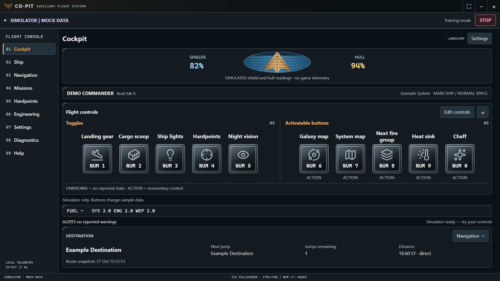
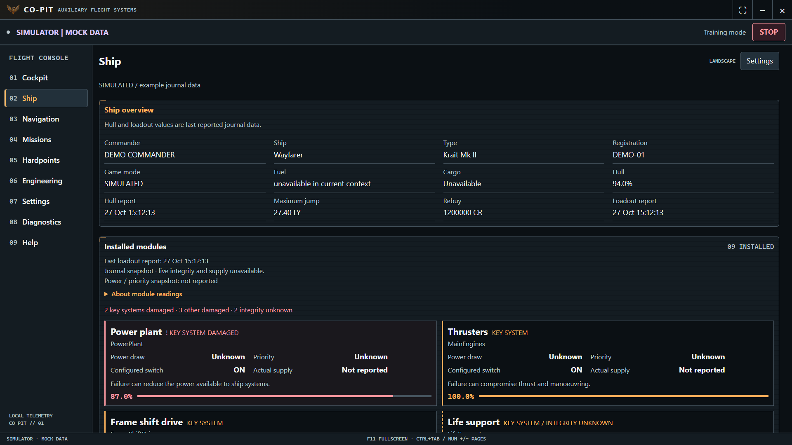
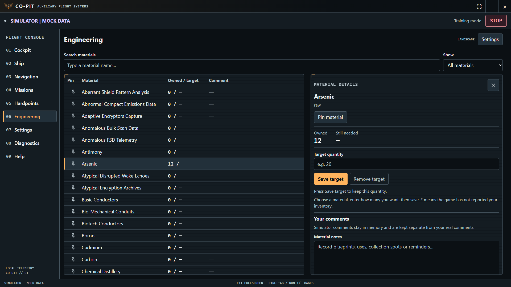

# Co-pit

A Windows cockpit companion for Elite Dangerous, with a desktop interface
and an optional Elite Aux terminal interface. Keep ship controls, navigation,
missions and engineering materials on a second screen.

## What it does

- Connects to the running game automatically and starts disarmed.
- Glass cockpit controls, separate toggles and triggers, and ship-aware utilities.
- Ship overview, module integrity warnings, reported power draw and priorities.
- Navigation, accepted missions, station outfitting and a manual fire-group reference.
- Engineering targets, pinned materials and your own saved comments.
- Three themes, adjustable interface size, portrait layouts and borderless fullscreen.

## Open the app

Double-click **Launch Co-pit.cmd** in the root folder.

It opens the desktop app from `build/bin`. If the app has not been built in
that folder, it offers to build it first. Source builds need **Go 1.26+** and
internet access for dependencies; running the desktop app needs **Microsoft
WebView2 Runtime**. Run one companion at a time. Set up the game controls
using the [setup guide](REAL-GAME-SETUP.md).

## More of the app

Screenshots show the current frontend with clearly simulated data.

| Ship and modules | Engineering |
|---|---|
|  |  |

## Documentation

- [User guide and screenshots](docs/user-guide.md)
- [Game setup and controls](REAL-GAME-SETUP.md)
- [Build, development and verification](docs/development.md)
- [Display sizing and supported layouts](docs/visual-readability-implementation.md)
- [Safety review](SAFETY-REVIEW.md) · [Test evidence](TEST-RESULTS.md)

## License

Copyright © 2026 CapraarpaC. Noncommercial reuse with attribution is allowed
under the [Co-pit Noncommercial License](LICENSE). Monetized versions require
a [separate commercial agreement](COMMERCIAL.md). Third-party code retains
its [own licences](licenses/).
